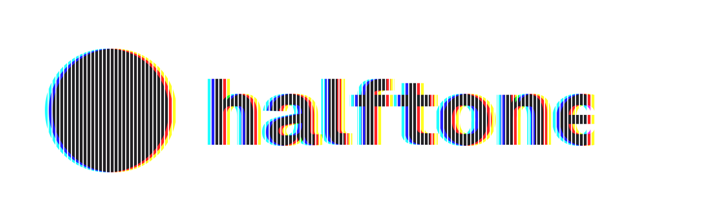
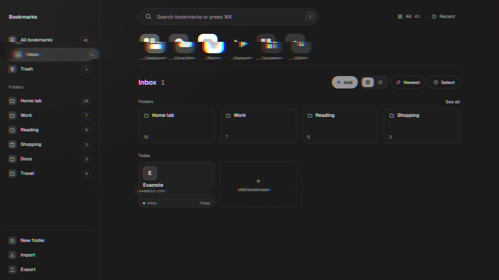
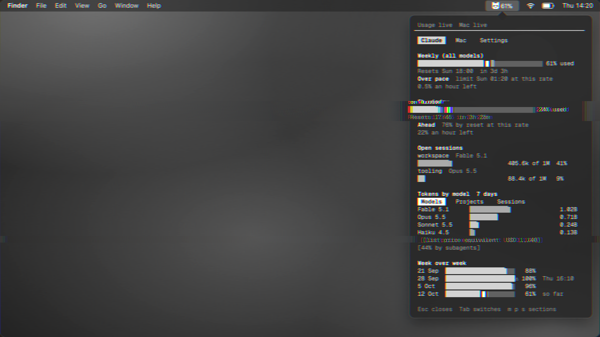

<picture>
  <source media="(prefers-color-scheme: dark)" srcset="assets/banner-dark.svg">
  
</picture>

Product and experience, from idea to release.

<table>
<tr>
<td width="50%" valign="top">

<h3>Pinned</h3>
Self-hosted bookmarks for the services on your server and every link you keep. Folders, one user, one SQLite file.
  
<a href="https://pinned.cc">pinned.cc</a> &nbsp; <a href="https://github.com/pinned-cc/pinned">source</a>
</td>
<td width="50%" valign="top">

<h3>tokenpanda</h3>
A macOS menu bar app that says whether you are ahead of the clock on your Claude plan, or behind it.
  
<a href="https://tokenpanda.dev">tokenpanda.dev</a> &nbsp; <a href="https://github.com/tokenpandadev/tokenpanda-app">source</a>
</td>
</tr>
</table>
